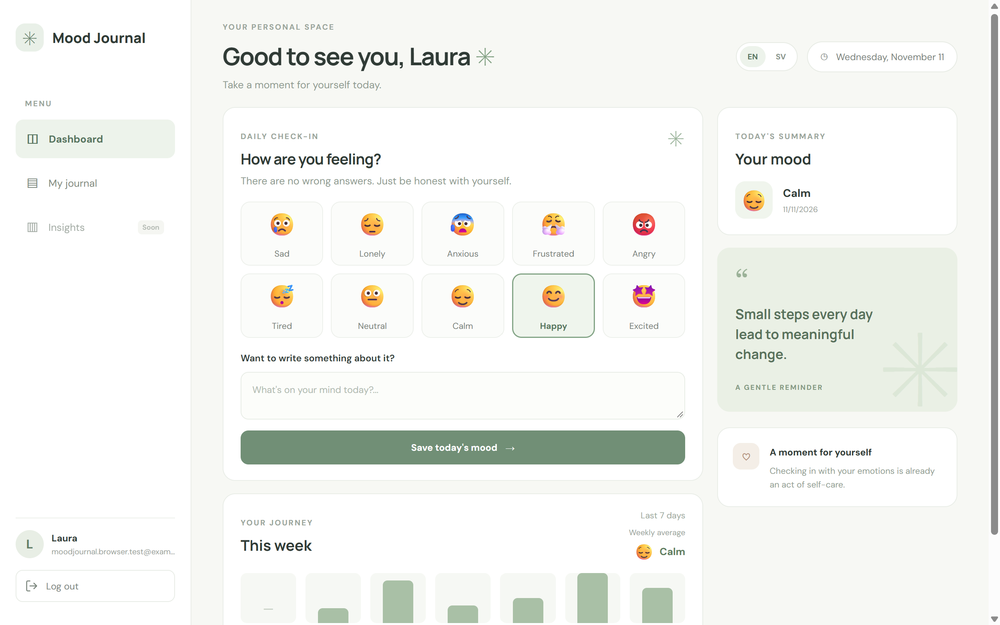
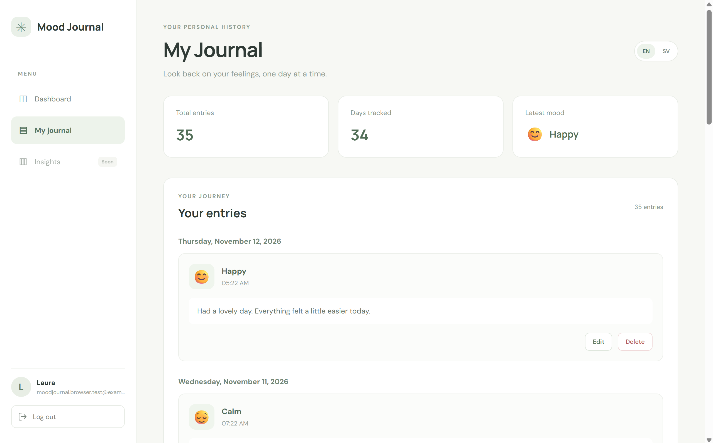
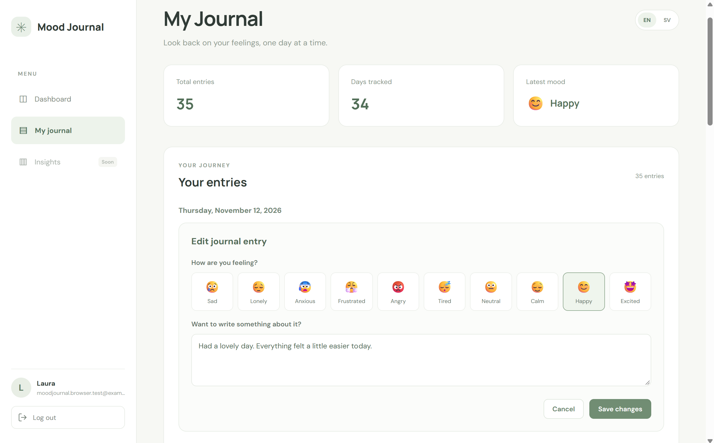
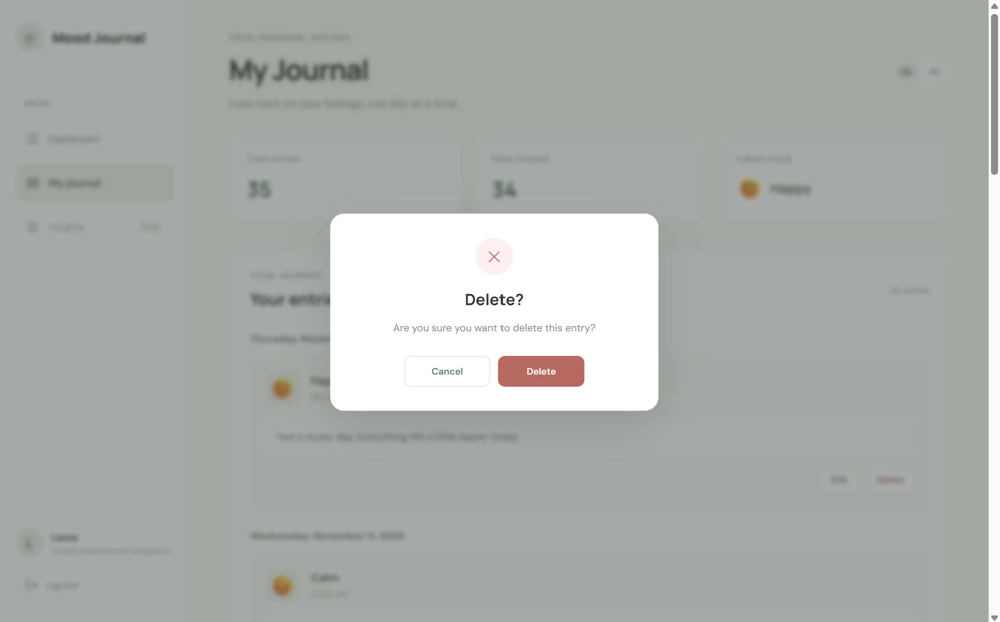

# Mood Journal

Mood Journal is a mood tracking and self-reflection web application
designed to help users record their emotions, monitor mood patterns, and
reflect on their well-being.

Authenticated users can register, log in, complete daily mood check-ins,
add optional notes, review their mood history, edit or delete previous
entries, and view dashboard summaries and weekly mood visualizations.

The application supports English and Swedish and consists of a Nuxt
frontend and a Laravel REST API backed by PostgreSQL.

## Live Demo

**[Open Mood Journal](https://mood-journal-frontend-l228.onrender.com)**

The application is hosted on Render. Because the services use Render's
free tier, they may spin down after a period of inactivity. The first
visit after inactivity can therefore take a little while while the
services start up.

**Please note:** During this startup period, the backend may not be
ready to handle registration requests immediately. If you encounter an
error when registering, wait up to one minute and try again once the
services have had time to start.

## Screenshots

### Dashboard



### My Journal



### Editing an Entry



### Delete Confirmation



## Tech Stack

### Frontend

- Nuxt 4
- Vue 3
- TypeScript
- Vue I18n (`@nuxtjs/i18n`)
- Nitro server routes

### Backend

- Laravel 13
- PHP 8.4
- Laravel Sanctum

### Database

- PostgreSQL
- Neon

### Containerization and Hosting

- Docker
- Apache HTTP Server
- Render
- Neon

## Architecture

The application consists of three main parts:

- **Frontend:** A Nuxt application responsible for the user interface,
  navigation, localization, and client-side interactions.
- **Backend:** A Laravel REST API responsible for authentication,
  request validation, application logic, and database operations.
- **Database:** A PostgreSQL database hosted on Neon.

The frontend communicates with the Laravel backend through HTTP requests
and JSON responses.

### Production API Proxy

The frontend and backend are deployed as separate Render services, which
means they have different hostnames. This created an authentication
issue with Laravel Sanctum's cookie-based SPA authentication: the
browser was interacting with the frontend domain while the CSRF and
session cookies belonged to the backend domain.

To address this, a Nuxt server-side proxy was added at:

`frontend/server/routes/backend/[...].ts`

Browser requests now use the frontend's `/backend` path. The Nuxt server
forwards those requests to the Laravel backend, including the request
headers and cookies required by Sanctum.

This keeps browser-facing requests on the frontend domain and avoids
relying on frontend JavaScript to read cookies belonging to a different
domain.

The proxy target is configured through Nuxt runtime configuration:

- `runtimeConfig.apiBase` is the server-side backend URL. It defaults
  to `http://localhost:8000` for local development and is overridden
  in production by `NUXT_API_BASE`.
- `runtimeConfig.public.apiBase` is `/backend`, so browser-side API
  calls use the Nuxt proxy rather than calling the backend hostname
  directly.

This configuration resolves the cross-domain CSRF and session-cookie
issue while keeping the frontend and backend independently deployable.

## Features

### Authentication

- User registration, login, and logout.
- Session-based authentication using Laravel Sanctum.
- CSRF protection for state-changing requests.
- Protected API endpoints using the `auth:sanctum` middleware.
- Cookie-based session handling.
- Shared authentication layout for consistent login and registration
  pages.
- Automatic redirection to the login page when an authenticated
  session is unavailable.

### Dashboard

- Responsive, component-based dashboard.
- Daily mood check-in with an optional note.
- Ten available mood categories.
- Mood entries persisted in PostgreSQL.
- Today's mood summary based on saved entries.
- Weekly mood overview calculated from saved check-ins.
- Inspirational content and self-care reminders.
- Dashboard data refreshed after a successful check-in.
- Responsive sidebar navigation.

### My Journal

- Chronological history of saved mood entries.
- Entries grouped by date.
- Localized dates and timestamps.
- Paginated history, with 10 entries per page.
- Total number of saved entries.
- Number of distinct days tracked.
- Latest mood summary.
- Inline editing of existing entries.
- Custom confirmation dialog before deleting an entry.
- Loading, empty, success, and error states.
- Automatic refresh after editing or deleting an entry.

### Internationalization

- English and Swedish translations.
- Language switcher on the dashboard, journal, login, and registration
  pages.
- Localized navigation and interface labels.
- Localized mood names and weekdays.
- Localized authentication pages, including labels, buttons, links,
  and error messages.
- Language-aware navigation between pages.
- Browser language detection and persistence of the selected language
  through a cookie.

### User Data and Security

- Each user can access only their own mood entries.
- Mood entry operations are protected by Laravel Sanctum
  authentication.
- Backend validation restricts mood values to the supported
  categories.
- Optional notes are limited to 2,000 characters.
- Update and delete operations verify entry ownership before making
  changes.

## Project Structure

```text
mood-journal/
├── backend/
│   ├── app/
│   │   ├── Http/
│   │   │   └── Controllers/
│   │   ├── Models/
│   │   └── Providers/
│   ├── bootstrap/
│   ├── config/
│   ├── database/
│   │   ├── factories/
│   │   ├── migrations/
│   │   └── seeders/
│   ├── routes/
│   │   └── api.php
│   ├── tests/
│   │   └── Feature/
│   └── Dockerfile
│
├── frontend/
│   ├── app/
│   │   ├── components/
│   │   │   ├── auth/
│   │   │   ├── dashboard/
│   │   │   └── journal/
│   │   ├── composables/
│   │   ├── pages/
│   │   └── app.vue
│   ├── i18n/
│   │   └── locales/
│   │       ├── en.json
│   │       └── sv.json
│   ├── public/
│   │   └── mood-journal-favicon.png
│   ├── server/
│   │   └── routes/
│   │       └── backend/
│   │           └── [...].ts
│   ├── nuxt.config.ts
│   └── package.json
│
└── docs/
    └── images/
        └── mood-journal-dashboard.png
```

## Getting Started

### Requirements

- PHP 8.4
- Composer
- Node.js and npm
- PostgreSQL database

### 1. Clone the repository

```bash
git clone https://github.com/laura-baraldi/mood-journal.git
cd mood-journal
```

### 2. Backend Setup

Navigate to the backend directory:

```bash
cd backend
```

Install PHP dependencies:

```bash
composer install
```

Create the environment file:

```powershell
Copy-Item .env.example .env
```

Generate the application key:

```bash
php artisan key:generate
```

Configure the database connection in `backend/.env`:

```env
DB_CONNECTION=pgsql
DB_HOST=your-database-host
DB_PORT=5432
DB_DATABASE=your-database-name
DB_USERNAME=your-database-username
DB_PASSWORD=your-database-password
DB_SSLMODE=require
```

For local development, configure the Sanctum stateful domain and session
settings for the local frontend:

```env
SANCTUM_STATEFUL_DOMAINS=localhost:3000
SESSION_DOMAIN=null
SESSION_SECURE_COOKIE=false
```

Run the database migrations:

```bash
php artisan migrate
```

Start the Laravel development server:

```bash
php artisan serve
```

The backend will be available at `http://localhost:8000`.

### 3. Frontend Setup

Open a second terminal and navigate to the frontend directory:

```bash
cd frontend
```

Install dependencies:

```bash
npm install
```

Start the Nuxt development server:

```bash
npm run dev
```

The frontend will be available at `http://localhost:3000`.

## Authentication and CSRF Flow

The application uses Laravel Sanctum's stateful SPA authentication. It
relies on session cookies rather than personal access tokens.

The authentication flow is:

1.  The frontend requests the CSRF cookie from Laravel Sanctum.
2.  The browser stores the CSRF cookie.
3.  For state-changing requests, the XSRF token is sent in the request
    headers.
4.  Laravel validates the credentials and creates an authenticated
    session.
5.  The browser sends the session cookie with subsequent requests.
6.  Protected API endpoints use `auth:sanctum` to verify the
    authenticated session.

The frontend sends requests with credentials enabled so that the
relevant cookies are included.

In production, browser requests go to the Nuxt `/backend` proxy. The
proxy forwards them to Laravel, so the browser does not need to make
cross-origin API requests directly to the backend service.

## API Endpoints

The following endpoints are exposed by the Laravel backend. In the
deployed frontend, browser requests are made through the Nuxt proxy by
prefixing the paths with `/backend`.

---

Method Backend endpoint Description Authentication

---

GET `/sanctum/csrf-cookie` Retrieve the CSRF No
cookie

POST `/api/register` Register a new No
user

POST `/api/login` Authenticate a No
user

POST `/api/logout` End the Yes
authenticated  
 session

GET `/api/user` Retrieve the Yes
authenticated  
 user

GET `/api/mood-entries` Retrieve Yes
paginated mood  
 entries and  
 statistics

POST `/api/mood-entries` Create a mood Yes
entry

PATCH `/api/mood-entries/{id}` Update an Yes
existing mood  
 entry

DELETE `/api/mood-entries/{id}` Delete a mood Yes
entry

---

For example, the browser-facing production path for updating an entry
is:

`/backend/api/mood-entries/{id}`

The Nuxt server forwards the request to the backend's
`/api/mood-entries/{id}` endpoint.

### Mood Entries Response

The `GET /api/mood-entries` endpoint returns a paginated response
containing:

- `data`: mood entries for the current page.
- `meta`: pagination information, including current page, last page,
  page size, and total entries.
- `stats`: total entries and the number of distinct days tracked.

Pagination is handled by Laravel, with 10 entries per page. Statistics
are calculated across the user's complete entry history rather than only
the current page.

## Deployment

The application is deployed as separate frontend and backend services on
Render, with PostgreSQL hosted on Neon.

### Frontend

The Nuxt frontend is deployed as a separate Render web service.

Configure the following environment variable in the Render frontend
service:

```env
NUXT_API_BASE=https://your-backend-service.onrender.com
```

Replace the example value with the URL of the deployed Laravel backend.

Nuxt uses this value as the server-side proxy target. The public API
base remains `/backend`, so browser requests are routed through the
frontend service.

### Backend

The Laravel backend is packaged as a Docker image using
`backend/Dockerfile`.

The Dockerfile:

- Uses `php:8.4-apache` as its base image.
- Installs the PHP extensions required by the application and
  PostgreSQL, including `pdo_pgsql`, `mbstring`, `bcmath`, and
  `opcache`.
- Installs Composer dependencies without development packages.
- Configures Apache to serve Laravel's `public/` directory.
- Configures Apache to listen on port `10000`.

The image exposes port `10000` and starts Apache in the foreground.

Render builds and deploys the backend from the configured GitHub branch
using the repository's Dockerfile. Database credentials and application
secrets are supplied through the Render service environment rather than
baked into the image.

### Database

PostgreSQL is hosted on Neon as a managed database service.

The database is not included in the backend Docker image. The backend
connects to Neon using the configured environment variables.

### Environment Variables

Configure the Laravel environment variables in the Render backend
service, including:

- `APP_KEY`
- `APP_ENV`
- `APP_DEBUG`
- `APP_URL`
- PostgreSQL connection settings for Neon.
- Appropriate Sanctum and session settings for the deployed frontend.

Do not commit `.env` files, database credentials, application keys, or
other secrets to the repository. Configure production secrets through
Render's environment settings.

## Docker

The Dockerfile is located at `backend/Dockerfile`.

To build the backend image locally from the repository root:

```bash
docker build -t mood-journal-backend ./backend
```

To run the container locally, provide the Laravel environment variables
and map the container's Apache port:

```bash
docker run --rm -p 10000:10000 --env-file backend/.env mood-journal-backend
```

The `.dockerignore` file excludes local environment files, dependencies,
logs, caches, tests, and documentation from the Docker build context.

Create `backend/.env` with valid local settings before running the
container. The container still needs access to a reachable PostgreSQL
database; the database is not included in this image.

## Development Commands

### Backend

Run the Laravel development server:

```bash
php artisan serve
```

Run database migrations:

```bash
php artisan migrate
```

Run backend tests:

```bash
php artisan test
```

Clear the Laravel configuration cache:

```bash
php artisan config:clear
```

### Frontend

Start the development server:

```bash
npm run dev
```

Build the production application:

```bash
npm run build
```

Preview the production build locally:

```bash
npm run preview
```

## Development Roadmap

Planned improvements include:

- Calendar-based visualization of historical mood entries.
- Mood intensity tracking.
- Expanded mood trends and insights.
- Additional analytics and self-reflection tools.
- Further automated test coverage.

The Insights section is currently marked as coming soon in the
application.

## Project Status

Mood Journal currently includes:

- User registration and authentication.
- A responsive dashboard with daily mood check-ins.
- Persistent mood entries stored in PostgreSQL.
- Weekly mood visualizations and dashboard summaries.
- A dedicated journal history with pagination and statistics.
- Inline editing and deletion of saved mood entries.
- English and Swedish localization.
- Responsive navigation and a custom application favicon.
- A separate production deployment for the frontend and backend.
- A Nuxt server-side API proxy supporting Laravel Sanctum
  authentication across the separately hosted services.

The application is an ongoing project focused on improving the user
experience, expanding mood analysis features, and strengthening
automated test coverage.
